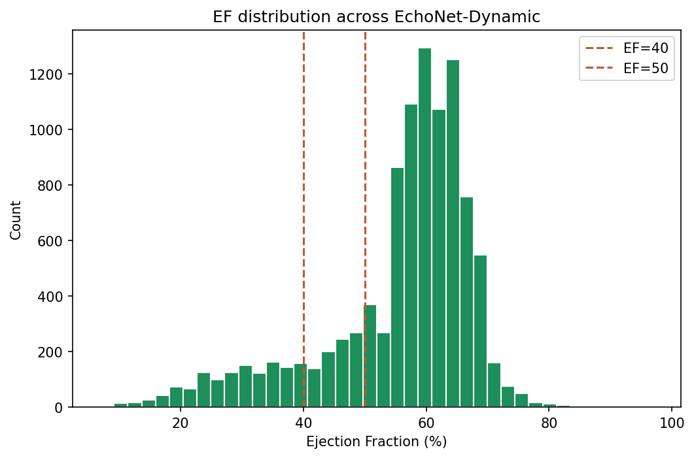
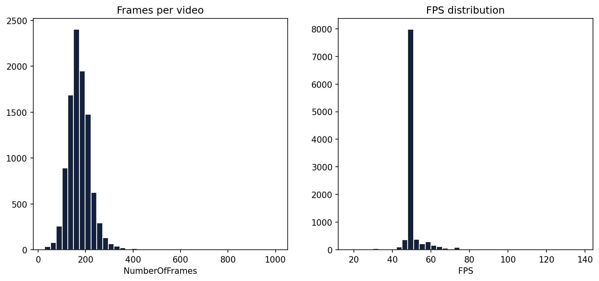
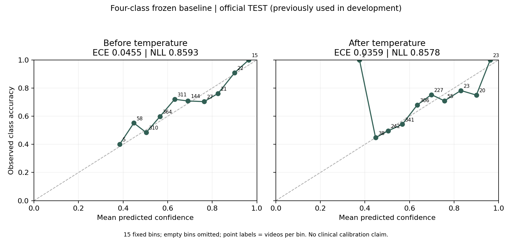
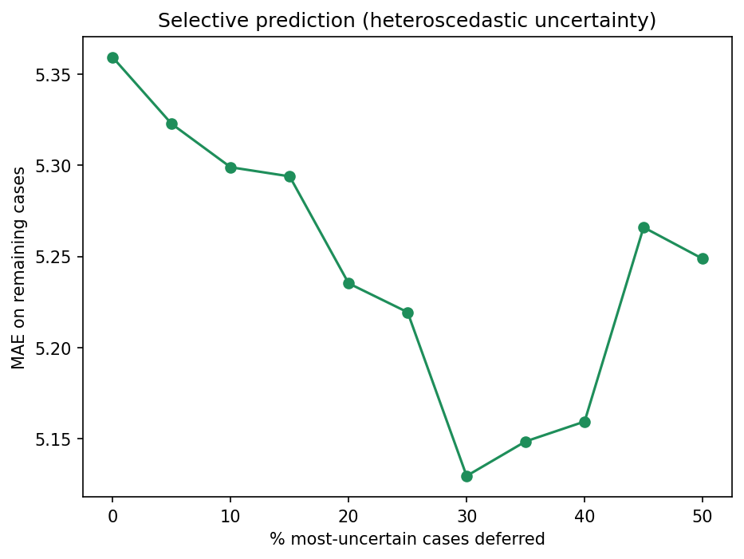
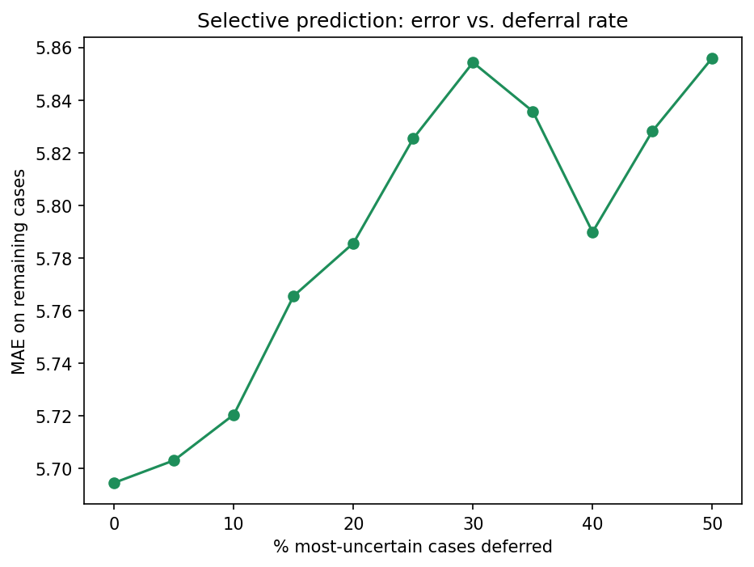
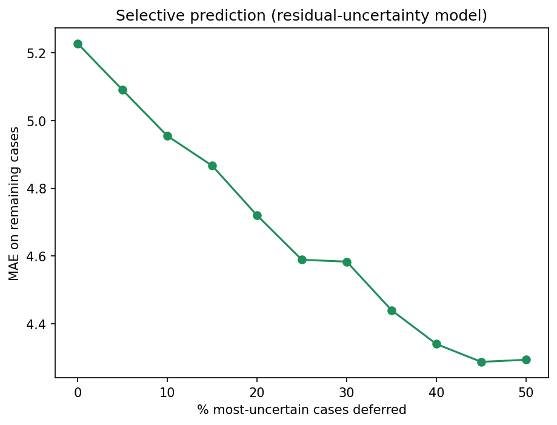

# Included graph guide

These six figures are the reviewed aggregate graphs included with the Echo-EF source update dated 8 November 2026. They contain binned distributions, reliability summaries or aggregate deferral curves, not ultrasound frames or labelled per-video records. The original images are preserved; no new evaluation or calibration was run to prepare this guide.

The figures answer different questions and come from different saved analyses. They must not be combined into one main-model performance claim. VAL and TEST were reused during development. None is external validation, a clinical safety result or a guarantee for new scans.

## Dataset distributions

### EF distribution

Source: existing dataset exploratory analysis. Bars show the dataset EF distribution; the dashed lines mark the project's reporting cutoffs. The large higher-EF group helps explain why overall group accuracy can hide weak Mildly reduced recall. This is a dataset summary, not model accuracy or a demographic-fairness analysis. The figure does not claim an independently held-out cohort.

### Frames per video and frame rate

Source: existing dataset exploratory analysis. The two panels summarize video length in frames and FPS. They describe the input collection, not an automatic scan-quality or view-validation system. No specific scan's identity is shown.

## Original None four-class probability calibration

Source: the completed frozen **original None epoch-18 four-class R3D** calibration analysis, not the main three-derived-group app and not the newer Swin pair. The graph labels the official TEST split as previously used in development. Temperature was fitted on 645 reserved VAL videos and frozen before this recorded 1,277-video TEST evaluation.

The panels use 15 fixed equal-width confidence bins; empty bins are omitted and point labels are bin counts, not video IDs. ECE changed from 0.045522 to 0.035888 and NLL from 0.859274 to 0.857791. Rounded values appear in the figure. Temperature does not change EF regression or argmax classes: four-class macro F1 remains 0.4929. Small probability-score changes are not a statistically established general calibration gain. The fitted temperature cannot transfer to another checkpoint.

The graph's source report and associated local calibration files are not distributed in this source update. Their evidence paths are recorded in the main README.

## Historical uncertainty deferral curves

For all three curves, the horizontal axis is the percentage of highest-uncertainty cases excluded. The vertical axis is MAE **only among the remaining cases**. Deferral is not an improved prediction for all videos and is not validated patient triage.

These historical result records lack complete generating-checkpoint fingerprints. They are retained as historical research findings, not a fresh TEST evaluation of the current app's hash-verified residual pair. Do not attach their coverage or error values to a different model merely because the filename is similar.

### Heteroscedastic uncertainty: no useful ranking established

The saved analysis found constant predicted sigma. Therefore sigma cannot rank videos by expected error. Changes in retained-set MAE as tied scores are removed can depend on ordering and must not be read as successful uncertainty selection. This is a negative method result, even though parts of the line descend. The curve alone does not establish useful ranking.

### MC Dropout: negative ranking result

The curve generally worsens as more nominally uncertain cases are removed. The corresponding saved uncertainty/error association was weak and negative, not useful error ranking. Keep this failure visible rather than presenting MC Dropout as validated confidence.

### Residual uncertainty: modest historical error ranking

The historical analysis reports modest uncertainty/error ranking (Spearman 0.2299). Deferring the highest-uncertainty 20% reduced retained-set MAE from 5.2276 to 4.7200 EF points. The excluded 20% are not counted in that retained-set MAE. Around 40 to 50% deferral is needed to approach 4.3 points in the saved curve; this is not the result at 20% deferral.

The current app's residual experiment uses a separate mean checkpoint, error head and VAL calibration. Because the historical aggregate record does not fully identify its generating pair, this curve is not proof that the current pair reproduces those historical TEST results. Neither selection independence nor a clinical range guarantee is established.

## Images intentionally not included

- Ultrasound frames and attribution overlays on those frames.
- Per-video scatter, sigma-versus-error and Bland-Altman plots. Their individual points go beyond this update's aggregate-only graph scope.
- Historical duplicate plots and plots with stale R-squared labels. In particular, old squared-Pearson values must not be labelled true coefficient-of-determination R-squared.
- Per-video prediction files, IDs, model weights and dataset files.

Excluding these from the current tree does not erase earlier commits. See the README's repository-history warning. This guide does not make a legal claim that every unlabeled scatter plot is prohibited; it documents the conservative publication scope chosen for this source update.
